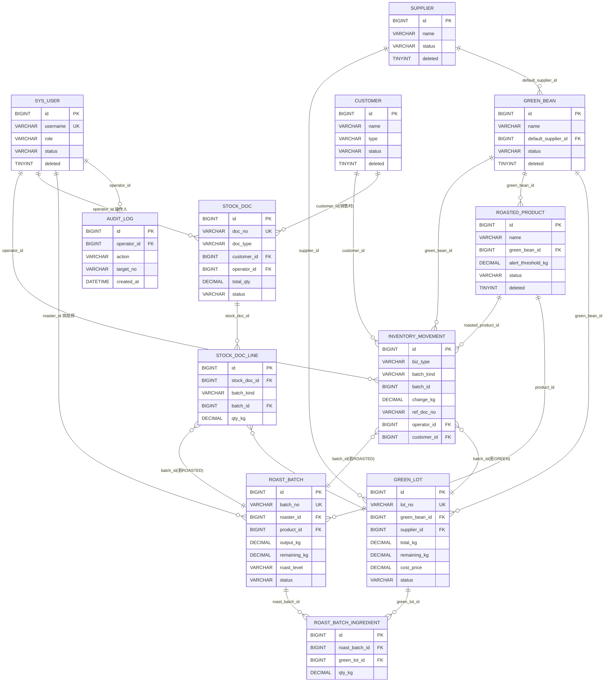

# craft-bean 数据库表结构

- 版本：v0.1
- 日期：2026-09-02
- 关联：[MVP 需求](./requirements/mvp-requirements.md) · [M1 详细需求](./requirements/m1-backoffice-detail.md) · [M1 技术设计](./superpowers/specs/2026-09-02-m1-backoffice-design.md)

> 本文是**字段级表结构参考**：已建表以 Flyway 迁移 + 实体为准，待建表为 DDL 草案（字段级细节在 S2–S5 实施时定稿）。技术设计与业务逻辑以技术设计 spec 为准。

---

## 1. 概览

| 项 | 值 |
|---|---|
| 数据库 | MySQL 8，库名 `craftbean`，字符集 `utf8mb4`，引擎 InnoDB |
| ORM | MyBatis-Plus（`map-underscore-to-camel-case: true`，逻辑删除 `deleted` 0/1） |
| 迁移 | Flyway，`server/src/main/resources/db/migration/V*.sql` |
| 时区 | `Asia/Shanghai`（连接 `serverTimezone` + Jackson 全局） |

### 表清单与状态

| # | 表 | 用途 | 里程碑 | 状态 |
|---|---|---|---|---|
| 1 | `sys_user` | 系统用户 | S1 | ✅ 已建 |
| 2 | `audit_log` | 操作审计日志 | S1 | ✅ 已建 |
| 3 | `supplier` | 供货商档案 | S2 | ✅ 已建 |
| 4 | `customer` | 客户档案 | S2 | 🔲 待建 |
| 5 | `green_bean` | 生豆品种档案 | S2 | ✅ 已建 |
| 6 | `roasted_product` | 熟豆商品 | S2 | 🔲 待建 |
| 7 | `green_lot` | 生豆采购批＝生豆库存批 | S3 | ✅ 已建 |
| 8 | `roast_batch` | 烘焙批次＝熟豆库存批 | S4 | 🔲 待建 |
| 9 | `roast_batch_ingredient` | 烘焙用料明细 | S4 | 🔲 待建 |
| 10 | `stock_doc` | 出入库单头 | S5 | 🔲 待建 |
| 11 | `stock_doc_line` | 出入库单明细 | S5 | 🔲 待建 |
| 12 | `inventory_movement` | 库存流水（只增不改） | S3–S5 共用 | ✅ 已建 |

### 1.1 ER 图（表间关系）



> **读图说明**
> - 所有关联均为**软外键**（无 DB 级约束），靠应用层维护。
> - `STOCK_DOC_LINE` 与 `INVENTORY_MOVEMENT` 的 `batch_id` 是**多态关联**：按 `batch_kind` 取值指向 `green_lot.id`（`GREEN`）或 `roast_batch.id`（`ROASTED`），图中两条边表示「二选一」目标，并非同时指向两者。
> - `INVENTORY_MOVEMENT` 为 append-only 流水，经 `ref_doc_no` 反查单据；`roasted_product_id` / `green_bean_id` 用于按品种维度汇总。

---

## 2. 全库约定

- **主键**：`id BIGINT AUTO_INCREMENT PRIMARY KEY`。
- **审计时间**：`created_at DATETIME NOT NULL DEFAULT CURRENT_TIMESTAMP`；`updated_at DATETIME NOT NULL DEFAULT CURRENT_TIMESTAMP ON UPDATE CURRENT_TIMESTAMP`。
- **软删除**：`deleted TINYINT NOT NULL DEFAULT 0`（0 未删 / 1 已删），由 MyBatis-Plus `@TableLogic` 全局拦截。**仅主数据表**使用；单据/流水用 `status` 作废或 append-only，不加 `deleted`（见 §5）。
- **重量**：`kg` 用 `DECIMAL(10,3)`（支持 0.001 kg 精度）。
- **金额**：`DECIMAL(10,2)`（元）。
- **时间**：一律 `DATETIME`（北京时间）；日期用 `DATE`。
- **外键**：**软关联**，无 DB 级 `FOREIGN KEY` 约束，靠应用层保证一致性（与现有 `audit_log.operator_id → sys_user.id` 一致）。
- **业务编号**：`lot_no` / `batch_no` / `doc_no` 加 `UNIQUE KEY`，格式如 `GB-2026-0001` / `RB-2026-0001`。
- **关联字段命名**：`xxx_id BIGINT` 指向被关联表的 `id`。

---

## 3. 已建表

### 3.1 `sys_user` 系统用户

来源：`V1__init_sys_user.sql` + `V2` 增量（`failed_attempts`、`locked_until`）。实体 `SysUser`。

| 列 | 类型 | 可空 | 默认 | 说明 |
|---|---|---|---|---|
| `id` | BIGINT AI | 否 | — | 主键 |
| `username` | VARCHAR(50) | 否 | — | 登录名，唯一 `uk_username` |
| `password_hash` | VARCHAR(100) | 否 | — | BCrypt 哈希 |
| `name` | VARCHAR(50) | 否 | — | 姓名 |
| `role` | VARCHAR(20) | 否 | — | `ADMIN` / `STAFF` / `READONLY` |
| `status` | VARCHAR(20) | 否 | `ACTIVE` | `ACTIVE` / `DISABLED` |
| `last_login_at` | DATETIME | 是 | — | 最后登录时间 |
| `failed_attempts` | INT | 否 | `0` | 连续登录失败次数（V2） |
| `locked_until` | DATETIME | 是 | — | 锁定截止时间（V2） |
| `created_at` | DATETIME | 否 | `CURRENT_TIMESTAMP` | |
| `updated_at` | DATETIME | 否 | `CURRENT_TIMESTAMP ON UPDATE` | |
| `deleted` | TINYINT | 否 | `0` | 逻辑删除 |

**种子数据**：`BootstrapDataInitializer` 启动时若无 `admin` 则建 `admin / admin123`（ADMIN / ACTIVE）。**登录锁定**：连续失败 5 次锁 15 分钟。

### 3.2 `audit_log` 操作审计日志

来源：`V2__lockout_and_audit_log.sql`。实体 `AuditLog`。append-only，无 `updated_at` / `deleted`。

| 列 | 类型 | 可空 | 默认 | 说明 |
|---|---|---|---|---|
| `id` | BIGINT AI | 否 | — | 主键 |
| `operator_id` | BIGINT | 是 | — | 操作人（软 FK → `sys_user.id`，系统操作可为空） |
| `action` | VARCHAR(50) | 否 | — | 动作编码，如 `LOGIN` / `USER_CREATE` |
| `target_no` | VARCHAR(100) | 是 | — | 关联单据/对象编号 |
| `detail` | VARCHAR(500) | 是 | — | 关键信息 |
| `created_at` | DATETIME | 否 | `CURRENT_TIMESTAMP` | |

**索引**：`idx_operator_created (operator_id, created_at)`、`idx_action (action)`。

### 3.3 `supplier` 供货商档案

来源：`V3__greenbean_inventory.sql`。实体 `Supplier`。主数据表，含 `deleted`。

| 列 | 类型 | 可空 | 默认 | 说明 |
|---|---|---|---|---|
| `id` | BIGINT AI | 否 | — | 主键 |
| `name` | VARCHAR(100) | 否 | — | 名称，唯一 `uk_supplier_name` |
| `contact_person` | VARCHAR(50) | 是 | — | 联系人 |
| `phone` | VARCHAR(30) | 是 | — | 电话 |
| `wechat` | VARCHAR(50) | 是 | — | 微信 |
| `address` | VARCHAR(255) | 是 | — | 地址 |
| `main_category` | VARCHAR(100) | 是 | — | 主营品类 |
| `status` | VARCHAR(20) | 否 | `ACTIVE` | `ACTIVE`/`DISABLED` 合作中/停用 |
| `created_at` | DATETIME | 否 | `CURRENT_TIMESTAMP` | |
| `updated_at` | DATETIME | 否 | `CURRENT_TIMESTAMP ON UPDATE` | |
| `deleted` | TINYINT | 否 | `0` | 逻辑删除 |

### 3.4 `green_bean` 生豆品种档案

来源：`V3__greenbean_inventory.sql`。实体 `GreenBean`。主数据表，含 `deleted`。

| 列 | 类型 | 可空 | 默认 | 说明 |
|---|---|---|---|---|
| `id` | BIGINT AI | 否 | — | 主键 |
| `name` | VARCHAR(150) | 否 | — | 品种名，唯一 `uk_green_bean_name` |
| `origin` | VARCHAR(100) | 是 | — | 产地 |
| `process` | VARCHAR(50) | 是 | — | 处理法 |
| `variety` | VARCHAR(80) | 是 | — | 豆种 |
| `default_supplier_id` | BIGINT | 是 | — | 默认供货商（软 FK → `supplier.id`） |
| `status` | VARCHAR(20) | 否 | `ACTIVE` | `ACTIVE`/`DISABLED` |
| `remark` | VARCHAR(500) | 是 | — | 杯测/风味 |
| `created_at` | DATETIME | 否 | `CURRENT_TIMESTAMP` | |
| `updated_at` | DATETIME | 否 | `CURRENT_TIMESTAMP ON UPDATE` | |
| `deleted` | TINYINT | 否 | `0` | 逻辑删除 |

### 3.5 `green_lot` 生豆采购批

来源：`V3__greenbean_inventory.sql` + V4（去掉 `deleted`）。实体 `GreenLot`。单据类，用 `status` 作废，无 `deleted`。

| 列 | 类型 | 可空 | 默认 | 说明 |
|---|---|---|---|---|
| `id` | BIGINT AI | 否 | — | 主键 |
| `lot_no` | VARCHAR(50) | 否 | — | 批次号，唯一 `uk_green_lot_no` |
| `green_bean_id` | BIGINT | 否 | — | 软 FK → `green_bean.id` |
| `supplier_id` | BIGINT | 否 | — | 软 FK → `supplier.id` |
| `purchase_date` | DATE | 否 | — | 采购日期 |
| `total_kg` | DECIMAL(12,3) | 否 | — | 采购总量 |
| `remaining_kg` | DECIMAL(12,3) | 否 | — | 剩余可用（库存余额） |
| `cost_price` | DECIMAL(12,2) | 否 | — | 采购单价 元/kg |
| `amount` | DECIMAL(14,2) | 否 | — | 金额 |
| `status` | VARCHAR(20) | 否 | `AVAILABLE` | `AVAILABLE`/`VOID` |
| `remark` | VARCHAR(500) | 是 | — | |
| `created_at` | DATETIME | 否 | `CURRENT_TIMESTAMP` | |
| `updated_at` | DATETIME | 否 | `CURRENT_TIMESTAMP ON UPDATE` | |

### 3.6 `inventory_movement` 库存流水

来源：`V3__greenbean_inventory.sql` + V4（去掉 `deleted`）。实体 `InventoryMovement`。append-only，无 `updated_at`、无 `deleted`。

| 列 | 类型 | 可空 | 默认 | 说明 |
|---|---|---|---|---|
| `id` | BIGINT AI | 否 | — | 主键 |
| `biz_type` | VARCHAR(40) | 否 | — | 如 `PURCHASE_IN` |
| `batch_kind` | VARCHAR(20) | 否 | `GREEN` | `GREEN`/`ROASTED` |
| `batch_id` | BIGINT | 否 | — | `green_lot.id` 或 `roast_batch.id` |
| `green_bean_id` | BIGINT | 是 | — | 软 FK → `green_bean.id` |
| `supplier_id` | BIGINT | 是 | — | 软 FK → `supplier.id` |
| `change_kg` | DECIMAL(12,3) | 否 | — | 入库+ / 出库− |
| `unit_price` | DECIMAL(12,2) | 是 | — | 单价 |
| `amount` | DECIMAL(14,2) | 是 | — | 金额 |
| `ref_doc_no` | VARCHAR(50) | 是 | — | 关联单号 |
| `operator_id` | BIGINT | 是 | — | 软 FK → `sys_user.id` |
| `movement_date` | DATE | 否 | — | 日期 |
| `remark` | VARCHAR(500) | 是 | — | |
| `created_at` | DATETIME | 否 | `CURRENT_TIMESTAMP` | |

**索引**：`idx_inventory_batch (batch_kind, batch_id, created_at)`、`idx_inventory_bean (green_bean_id, created_at)`、`idx_inventory_date (movement_date)`。

---

## 4. 待建表（M1 规划，DDL 草案）

> 以下为按技术设计 spec 推导的字段级草图，**非最终 DDL**；`org_id` 等开放项见 §5。

### S2 · 基础档案

#### `customer` 客户档案
```sql
CREATE TABLE customer (
    id             BIGINT AUTO_INCREMENT PRIMARY KEY,
    name           VARCHAR(100) NOT NULL,
    type           VARCHAR(20)  NOT NULL COMMENT 'WHOLESALE/RETAIL 批发/零售',
    contact_person VARCHAR(50)  NULL,
    phone          VARCHAR(30)  NULL,
    address        VARCHAR(200) NULL,
    status         VARCHAR(20)  NOT NULL DEFAULT 'ACTIVE',
    remark         VARCHAR(500) NULL,
    created_at     DATETIME     NOT NULL DEFAULT CURRENT_TIMESTAMP,
    updated_at     DATETIME     NOT NULL DEFAULT CURRENT_TIMESTAMP ON UPDATE CURRENT_TIMESTAMP,
    deleted        TINYINT      NOT NULL DEFAULT 0
) ENGINE = InnoDB DEFAULT CHARSET = utf8mb4 COMMENT = '客户档案';
```

#### `roasted_product` 熟豆商品
```sql
CREATE TABLE roasted_product (
    id                 BIGINT AUTO_INCREMENT PRIMARY KEY,
    name               VARCHAR(100)  NOT NULL,
    green_bean_id      BIGINT        NULL COMMENT '关联生豆品种 软FK→green_bean.id',
    default_roast_level VARCHAR(20)  NULL COMMENT '浅/中浅/中/中深/深',
    price              DECIMAL(10,2) NULL COMMENT '售价 M2启用,M1可先填',
    alert_threshold_kg DECIMAL(10,3) NULL COMMENT '库存预警阈值',
    status             VARCHAR(20)   NOT NULL DEFAULT 'ACTIVE' COMMENT '在售/停售',
    created_at         DATETIME      NOT NULL DEFAULT CURRENT_TIMESTAMP,
    updated_at         DATETIME      NOT NULL DEFAULT CURRENT_TIMESTAMP ON UPDATE CURRENT_TIMESTAMP,
    deleted            TINYINT       NOT NULL DEFAULT 0
) ENGINE = InnoDB DEFAULT CHARSET = utf8mb4 COMMENT = '熟豆商品';
```

### S4 · 烘焙批次

#### `roast_batch` 烘焙批次＝熟豆库存批
```sql
CREATE TABLE roast_batch (
    id              BIGINT AUTO_INCREMENT PRIMARY KEY,
    batch_no        VARCHAR(50)   NOT NULL COMMENT '如 RB-2026-0001',
    roast_date      DATE          NOT NULL,
    roaster_id      BIGINT        NOT NULL COMMENT '烘焙师 软FK→sys_user.id',
    equipment       VARCHAR(50)   NULL COMMENT '烘焙机位',
    product_id      BIGINT        NOT NULL COMMENT '熟豆商品 软FK→roasted_product.id',
    roast_level     VARCHAR(20)   NOT NULL COMMENT '浅/中浅/中/中深/深',
    total_in_kg     DECIMAL(10,3) NULL COMMENT '投入合计(自动求和)',
    output_kg       DECIMAL(10,3) NULL COMMENT '出炉量',
    remaining_kg    DECIMAL(10,3) NULL COMMENT '熟豆剩余(库存余额)',
    first_crack_at  VARCHAR(20)   NULL COMMENT '一爆时间',
    out_temp_c      DECIMAL(5,1)  NULL COMMENT '出炉温度℃',
    duration_min    INT           NULL COMMENT '总时长(分钟)',
    status          VARCHAR(20)   NOT NULL COMMENT 'DRAFT/QC/AVAILABLE/VOID 草稿/待质检/可售/已作废',
    remark          VARCHAR(500)  NULL,
    created_at      DATETIME      NOT NULL DEFAULT CURRENT_TIMESTAMP,
    updated_at      DATETIME      NOT NULL DEFAULT CURRENT_TIMESTAMP ON UPDATE CURRENT_TIMESTAMP,
    UNIQUE KEY uk_batch_no (batch_no)
) ENGINE = InnoDB DEFAULT CHARSET = utf8mb4 COMMENT = '烘焙批次';
```

#### `roast_batch_ingredient` 烘焙用料明细
```sql
CREATE TABLE roast_batch_ingredient (
    id             BIGINT AUTO_INCREMENT PRIMARY KEY,
    roast_batch_id BIGINT        NOT NULL COMMENT '软FK→roast_batch.id',
    green_lot_id   BIGINT        NOT NULL COMMENT '软FK→green_lot.id',
    qty_kg         DECIMAL(10,3) NOT NULL,
    created_at     DATETIME      NOT NULL DEFAULT CURRENT_TIMESTAMP,
    updated_at     DATETIME      NOT NULL DEFAULT CURRENT_TIMESTAMP ON UPDATE CURRENT_TIMESTAMP,
    KEY idx_batch (roast_batch_id)
) ENGINE = InnoDB DEFAULT CHARSET = utf8mb4 COMMENT = '烘焙用料明细';
```

### S5 · 熟豆出入库

#### `stock_doc` 出入库单头
```sql
CREATE TABLE stock_doc (
    id          BIGINT AUTO_INCREMENT PRIMARY KEY,
    doc_no      VARCHAR(50)   NOT NULL,
    doc_type    VARCHAR(20)   NOT NULL COMMENT 'IN/OUT_SALE/OUT_SAMPLE/OUT_WASTE/ADJUST',
    customer_id BIGINT        NULL COMMENT '销售时必填 软FK→customer.id',
    operator_id BIGINT        NOT NULL COMMENT '软FK→sys_user.id',
    total_qty   DECIMAL(10,3) NULL,
    status      VARCHAR(20)   NOT NULL DEFAULT 'ACTIVE' COMMENT 'ACTIVE/VOID',
    remark      VARCHAR(500)  NULL,
    created_at  DATETIME      NOT NULL DEFAULT CURRENT_TIMESTAMP,
    updated_at  DATETIME      NOT NULL DEFAULT CURRENT_TIMESTAMP ON UPDATE CURRENT_TIMESTAMP,
    UNIQUE KEY uk_doc_no (doc_no)
) ENGINE = InnoDB DEFAULT CHARSET = utf8mb4 COMMENT = '出入库单头';
```

#### `stock_doc_line` 出入库单明细
```sql
CREATE TABLE stock_doc_line (
    id            BIGINT AUTO_INCREMENT PRIMARY KEY,
    stock_doc_id  BIGINT        NOT NULL COMMENT '软FK→stock_doc.id',
    batch_kind    VARCHAR(10)   NOT NULL COMMENT 'GREEN/ROASTED',
    batch_id      BIGINT        NOT NULL COMMENT 'green_lot.id 或 roast_batch.id',
    qty_kg        DECIMAL(10,3) NOT NULL,
    created_at    DATETIME      NOT NULL DEFAULT CURRENT_TIMESTAMP,
    updated_at    DATETIME      NOT NULL DEFAULT CURRENT_TIMESTAMP ON UPDATE CURRENT_TIMESTAMP,
    KEY idx_doc (stock_doc_id)
) ENGINE = InnoDB DEFAULT CHARSET = utf8mb4 COMMENT = '出入库单明细';
```

### 关键联动（摘要）

- **采购入库**（S3）：建 `green_lot`（`remaining_kg = total_kg`）+ 写 `inventory_movement(+)`。不经 `stock_doc`。
- **烘焙出炉「合格」**（S4，最关键）：事务内逐行 `SELECT ... FOR UPDATE` 校验用料 `remaining_kg ≥ qty_kg` → 扣生豆 + 写生豆出库流水 → 建/更新 `roast_batch`（`remaining_kg = output_kg`）+ 写熟豆入库流水。任一不够整单回滚。
- **熟豆出库**（S5）：对 `remaining_kg>0` 的 `roast_batch` 行锁，按 `roast_date ASC, id ASC`（FIFO）分配 → 生成 `stock_doc_line`（可人工改批次）→ 扣 `remaining_kg` + 写出库流水。防负库存。
- **追溯**：熟豆批次 → 用料明细 → 生豆批次 → 供货商；流水按 `ref_doc_no` 回单据。

---

## 5. 待决策项（需你拍板）

| # | 问题 | 现状 / 选项 | 建议 |
|---|---|---|---|
| 1 | `org_id` 多租户预留列 | 技术设计建议「S0 建表即带 `org_id` 默认 1」，但已建的 `sys_user` / `audit_log` 未带。 | 新表统一加 `org_id BIGINT NOT NULL DEFAULT 1`；已建两张表用 V3 迁移回补 `org_id`，避免后期迁移。 |
| 2 | 软删除范围 | `sys_user` 有 `deleted`；单据/流水用 `status` 或 append-only。 | 主数据表（supplier/customer/green_bean/roasted_product）加 `deleted`；单据（green_lot/roast_batch/stock_doc）用 `status=VOID`；流水不加。 |
| 3 | 真实外键约束 | 已决策：维持软关联，无 DB 级 FK（V4 已去掉 V3 误建的真实 FK）。 | 维持软关联（便于迁移/冲销）。 |
| 4 | 编号生成 | `lot_no`/`batch_no`/`doc_no` 唯一键兜底，生成策略未定。 | DB 序列表 + 唯一键兜底（并发安全）。 |
| 5 | `first_crack_at` 类型 | 一爆时间，spec 未定。 | 暂用 `VARCHAR(20)`（如 `08:30` 或秒数），M2 升曲线再改结构化。 |

---

## 6. 实施顺序

S2（基础档案）→ S3（生豆采购 + 流水）→ S4（烘焙批次 + 联动，**技术风险最高**）→ S5（熟豆库存 + FIFO 出库）→ S6（日志完善 + 上线）。每里程碑独立可验收，每个迁移一个 `V{n}__xxx.sql`。

---

*本文随 S2–S5 实施持续更新；字段级 DDL 以各里程碑迁移脚本为最终准。*
